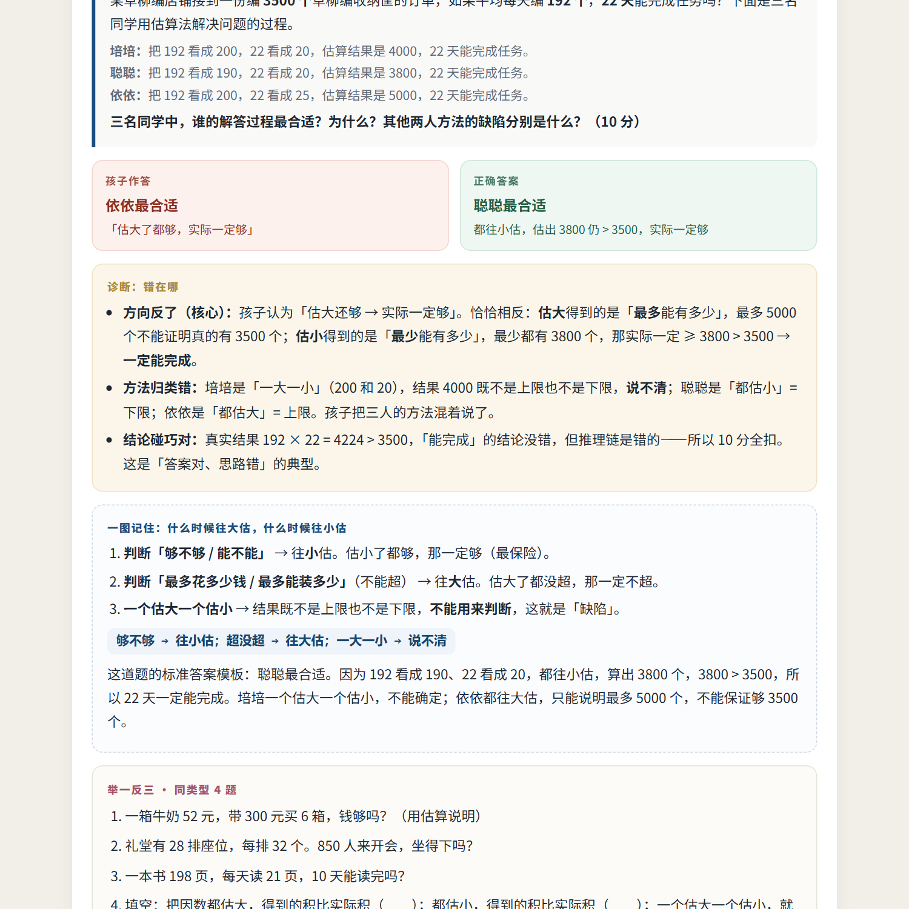
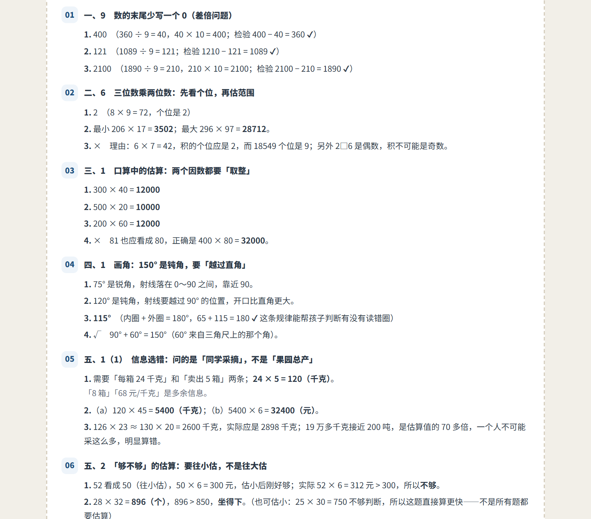

# exam-mistake-analysis

把一个孩子的**试卷扫描件**，做成一份家长能看懂、孩子能直接练的**错题分析报告**。

判断红笔批改痕迹 → 还原「孩子答的 / 正确的」→ 诊断错因（知识漏洞 / 思维断点 / 习惯问题）→ 按错因出同类型变式 → 排一张按遗忘曲线的复习表。

> 适用于 WorkBuddy / Claude Code 等支持 `SKILL.md` 的 Agent 环境；也可以不装技能，直接按 `SKILL.md` 里的流程手工用脚本跑。

## 效果

| 逐题分析（只出题，不给答案） | 最后一页：变式答案 |
|---|---|
|  |  |

## 三个固定设计

1. **答案只在最后一页**。正文卡片只给题目，配一句「答案在最后一页 · 先做完再看」。孩子翻不到答案，就不会偷看。
2. **时间三件套**。封面标「批改日期 / 报告生成 / 复习起点」，复习表从**批改日期**起算，不是从生成报告的那天。
3. **遗忘曲线复习表**。+1 / +3 / +7 / +15 / +30 天各一轮，每轮一个方框：电子版点一下变绿打钩（localStorage 记住），打印版是空心格，用笔钩。

## 安装

```bash
# 装成全局技能（WorkBuddy / Claude Code 都会自动读取 SKILL.md）
git clone git@github.com:jackholger6-sketch/exam-mistake-analysis.git \
  ~/.workbuddy/skills/exam-mistake-analysis
```

装好后直接跟 Agent 说「分析这张卷子的错题」，附上扫描件即可。只想手工跑脚本的话，克隆到任意目录也行。

## 快速开始

```bash
# 1. 依赖
pip install pillow pymupdf playwright

# 2. 卷子 PDF → 页面图
python scripts/prep_sheet.py 卷子.pdf -o pages --dpi 170

# 3. 逐题读图（这一步由 Agent/人完成），裁证据图
python scripts/crop.py pages/page_01.png 860,872,1400,940 evidence/e1.jpg --grid   # 先出坐标网格
python scripts/crop.py pages/page_01.png 860,872,1400,940 evidence/e1.jpg --width 900

# 4. 按 references/report-schema.md 填 report.json（照抄 examples/ 那份改）

# 5. 出 HTML + PDF
python scripts/build_report.py report.json -o 错题分析与举一反三_四年级数学.html
python scripts/make_pdf.py 错题分析与举一反三_四年级数学.html -o "错题分析与举一反三_四年级数学（含答案）.pdf"
```

`make_pdf.py` 用本机 Edge/Chrome 打印，不额外下载浏览器；没有的话也可以直接用浏览器「打印 → 另存为 PDF」。

## 目录

```
SKILL.md                      流程 + 铁律 + 常见坑（Agent 读这个）
assets/report-template.html   报告模板（改版式只改这里）
scripts/prep_sheet.py         卷子 → 页面图（PyMuPDF，失败退回抽内嵌 JPEG）
scripts/crop.py               页面图 → 证据图 / 坐标网格
scripts/build_report.py       report.json → HTML（答案页、复习表自动生成）
scripts/make_pdf.py           HTML → A4 PDF
references/report-schema.md   report.json 字段说明 + 写作要求
references/grader-marks.md    批改符号判读 + 错因五分类 + 怎么出「同类型」
examples/四年级数学_report.json  完整样例（7 道错题、24 道变式）
```

## 判读规则（摘要）

| 符号 | 含义 | 注意 |
|---|---|---|
| 扣分数字 `−1 −5 −10` | 错题定位的第一依据 | 先找它，再找叉 |
| `✗` | 错 | 符号常常很小，要放大 |
| 红色 `?` | 留白没写 | 是「没思路」，不是「算错」 |
| 长弧线 `✓` | 对 | 弧线长会穿过下一行，别误判 |

判读要过三层：符号层（扣分落在哪题）→ 笔迹层（孩子到底写了什么）→ 算术层（自己重算一遍）。三层都指向同一处才写「确定错题」，否则注明「按推断还原，以原卷为准」。

## 不做什么

- 不臆造卷面：看不清就标注推断，不编题。
- 不用「粗心」当结论。「粗心」解释不了任何事，家长也没法据此行动。
- 不把变式出成同一题的数字微调。换情境、换问法、换模型位置，并且每组至少放 1 道说理/判断题。

## License

MIT
